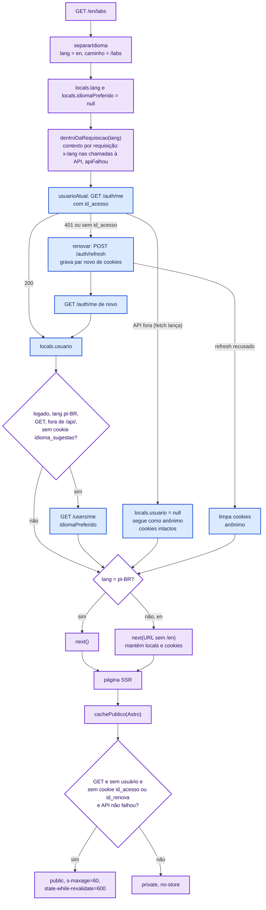
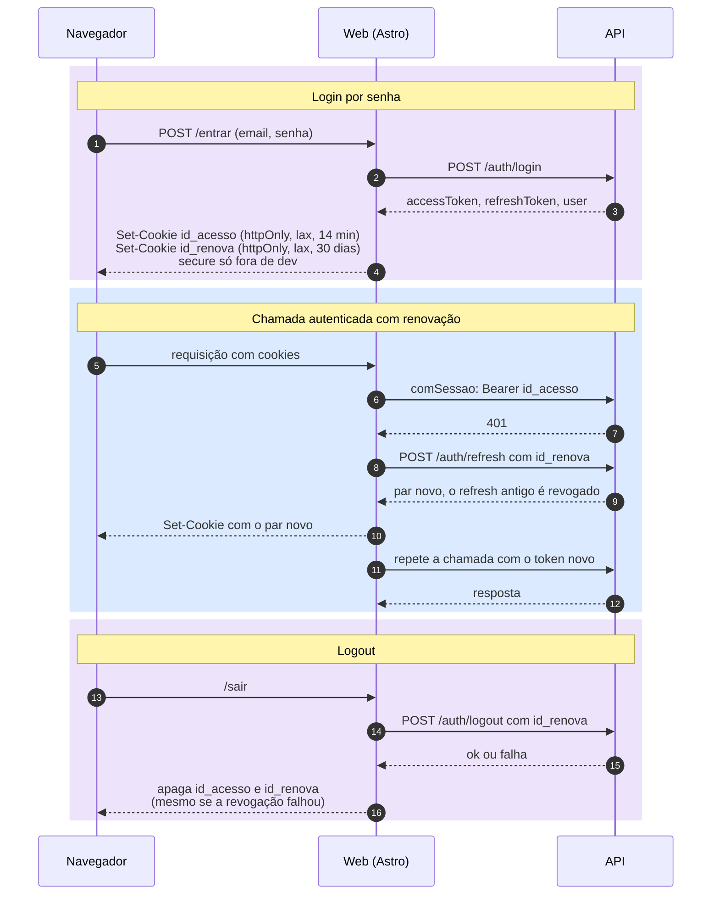
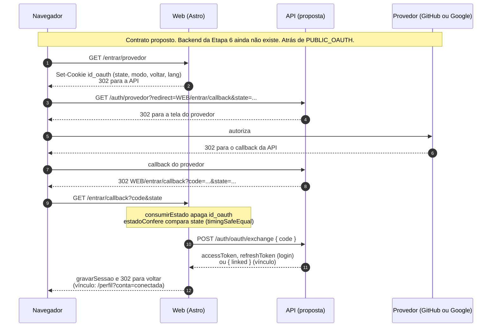
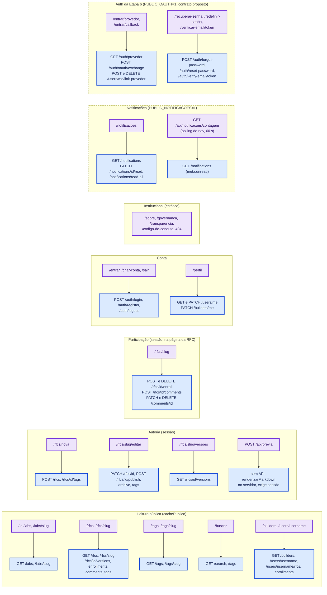

# @idearium/web

Frontend do Idearium: átrio, RFCs, laboratórios, perfis e as telas com sessão.
Astro 6 + React 19 + Tailwind 4, servido por um processo Node
(`@astrojs/node`, modo `standalone`). Fala com a API NestJS de `apps/api`.

## Rodar em dev, junto com a API

```bash
# 1. banco
docker run -d --name idearium-postgres \
  -e POSTGRES_DB=idearium -e POSTGRES_USER=idearium -e POSTGRES_PASSWORD=idearium_dev \
  -p 5432:5432 -v idearium_postgres_data:/var/lib/postgresql/data postgres:16-alpine

# 2. api
cp apps/api/.env.example apps/api/.env      # gerar JWT_ACCESS_SECRET
cd apps/api && npx prisma generate && npx prisma migrate deploy && npx prisma db seed
npm run dev:api                              # :3000

# 3. web (na raiz do monorepo)
npm run dev:web                              # :4321
```

As páginas são renderizadas no servidor a cada requisição, então **a API
precisa estar no ar para `dev` e para servir o app**. O `build` não chama a API.
Com a API fora do ar, `api.ts` nunca lança: a página sai sem conteúdo e com aviso.

## Variáveis

| Variável | Quando vale | Padrão | O que faz |
| :-- | :-- | :-- | :-- |
| `PUBLIC_API_URL` | **build** | `http://localhost:3000` | URL base da API (`src/lib/api.ts`, `src/lib/sessao.ts`). O prefixo `PUBLIC_` faz o Vite gravá-la no bundle, então trocar o valor exige novo build. |
| `HOST` | execução | `0.0.0.0` na imagem | Endereço em que o servidor Node escuta. |
| `PORT` | execução | `4321` | Porta do servidor Node. |
| `SITE_URL` | execução | `Astro.url.origin` | Origem pública do site (ex.: `https://idearium.org`, sem caminho). Só importa com `PUBLIC_OAUTH=1`: monta o `redirect` de volta do provedor (`/entrar/callback`). Atrás de proxy, `Astro.url.origin` sai com o host interno e o OAuth quebra; defina esta variável. Sem prefixo `PUBLIC_`, é lida a cada requisição, então trocar não exige novo build. Valor que não é URL é ignorado. |
| `NODE_ENV` | execução | `production` na imagem | Mantenha `production` em produção. |
| `PUBLIC_NOTIFICACOES` | **build** | desligada | `1` liga as notificações (F6): a rota `/notificacoes`, o endpoint `/api/notificacoes/contagem` e o marcador na nav. Com qualquer outro valor, a rota e o endpoint respondem 404 e a nav não mostra nada. Só ligue quando a API tiver `GET /notifications` (Etapa 5 do backend); antes disso a tela diz que a API ainda não oferece notificações. Como é `PUBLIC_`, trocar exige novo build. |
| `PUBLIC_TRADUCOES` | **build** | desligada | `1` lista, na RFC original, as traduções existentes. Precisa de `translations` no `GET /rfcs/:slug`; sem o campo, nada aparece. O "tradução de RFC-XXXX" e o "traduzir esta ideia" não dependem da flag. Contrato em `docs/contratos/ideia.md`. |
| `PUBLIC_ACOMPANHAR` | **build** | desligada | `1` liga o botão "acompanhar" na RFC (`POST/DELETE /rfcs/:id/follow`, estado em `GET /rfcs/:id/follow`) e a lista "o que acompanho" no `/perfil` (`GET /me/follows`). Sem contador público. Só ligue com o backend no ar. Contrato em `docs/contratos/ideia.md`. |
| `PUBLIC_OAUTH` | **build** | desligada | `1` liga a Etapa 6 no frontend: entrar com GitHub e Google (`/entrar/<provedor>`, `/entrar/callback`), `/recuperar-senha`, `/redefinir-senha`, `/verificar-email/<token>`, contas conectadas e aviso de email não verificado no perfil. Desligada, nada disso aparece e as rotas novas respondem 404. Só ligue quando a Etapa 6 do backend estiver no ar. Contrato em `ROADMAP_FRONTEND.md`. |
| `PUBLIC_CICLO` | **build** | desligada | `1` liga o fechamento do ciclo da ideia: "virou projeto" e "trazer de volta" no editar, atualizações de progresso na página da ideia e nota de mudança nas versões. Não cria rotas; desligada, nada disso aparece. Só ligue quando a API tiver os endpoints de `docs/contratos/ciclo.md`; antes disso, a tela diz que a API ainda não oferece o recurso. Como é `PUBLIC_`, trocar exige novo build. |
| `PUBLIC_MODERACAO` | **build** | desligada | `1` liga a moderação (C2): o link "reportar" nas ideias, nos comentários e nos perfis, `/reportar`, o painel `/moderacao` (só `MAINTAINER`) e `/contestar`, além dos estados "ocultada pela moderação" e "[suspenso]". Desligada, nada aparece e as rotas respondem 404; o código de conduta segue apontando o email. Só ligue quando a API tiver `POST /reports` e os endpoints `/admin/*`; antes disso as telas dizem que a API ainda não oferece o recurso. Contrato proposto em `docs/contratos/moderacao.md`. |
| `PUBLIC_CONTA` | **build** | desligada | `1` liga a frente C3: no `/perfil`, as seções de segurança (trocar senha, trocar email, sair de todos os aparelhos) e de dados (baixar meus dados); a rota `/excluir-conta`; `/confirmar-email/<token>`; e o download `/api/meus-dados`. Desligada, nada disso aparece e as rotas respondem 404. Só ligue quando a API tiver os endpoints do contrato proposto em `docs/contratos/conta.md`; sem eles, cada ação diz que a função ainda não está disponível. Os termos (`/termos`) e a política (`/privacidade`) não dependem da flag. |

### Cookies e HTTPS

Os tokens vivem em cookies `httpOnly` com `sameSite=lax` (`src/lib/sessao.ts`).
O atributo `secure` fica ligado quando o build é de produção
(`import.meta.env.PROD`). Por isso, em produção o app **precisa ser servido por
HTTPS**: em `http://` o browser descarta o cookie e o login não gruda. Rodar a
imagem em `http://localhost` serve para testar a renderização, mas não o login.

## Build e execução

```bash
npm run build:web                      # na raiz; gera apps/web/dist/
node apps/web/dist/server/entry.mjs    # HOST e PORT valem aqui
```

Checagem de tipos: `npm run check -w apps/web` (`astro check`, roda no CI).

## Testes

**Unitários** (Vitest, `tests/unit/`): funções puras de `src/lib` (markdown e
XSS, diff de versões, i18n, `destinoSeguro`, `cachePublico`) e um bloqueador de
acentos que falha se texto pt-BR dos dicionários ou das páginas institucionais
tiver palavra comum sem acento ("nao", "voce", "sessao"...). Não precisam de API
e rodam no CI.

```bash
npm run test -w apps/web
```

**E2E** (Playwright, `tests/e2e/`): rodam contra um web já no ar, sem subir
servidor. Projetos `desktop` e `mobile` (390x844). Cobrem as páginas públicas
em pt-BR e `/en` (status, `lang`, rolagem horizontal no celular, axe sem
violação serious/critical, cache público, nenhuma fonte do Google) e os fluxos
com conta: criar conta e sair, criar e publicar ideia com diff de versões,
inscrever-se e comentar.

```bash
# web em :4321 e API em :3000 já no ar (seção "Rodar em dev")
npx playwright install chromium          # uma vez
npm run e2e -w apps/web
BASE_URL=http://localhost:4321 API_URL=http://localhost:3000 npm run e2e -w apps/web
```

Os fluxos com conta **gravam no banco** da API (contas e ideias com prefixo
`e2e<tempo>`). Rode só contra o banco local de dev. Com o web ou a API fora,
ou se a API recusar a criação de conta, os testes são pulados com o motivo.
O e2e não roda no CI porque exigiria subir API e banco no job do web.

### Imagem Docker

O contexto é a raiz do monorepo, porque o build usa o `package-lock.json` e os
workspaces da raiz.

```bash
docker build -f apps/web/Dockerfile \
  --build-arg PUBLIC_API_URL=https://api.exemplo.org \
  -t idearium-web .

docker run --rm -p 4321:4321 idearium-web
```

A imagem usa `node:22-alpine` em estágios (deps, build, deps de produção,
runner), roda como o usuário `node` (não-root) e inicia com
`node apps/web/dist/server/entry.mjs`.

## Cache

As páginas públicas são SSR com `Cache-Control` público e curto quando a
requisição não traz sessão. Páginas com sessão nunca vão para cache
compartilhado. Atrás de CDN ou proxy reverso, o cache precisa respeitar
`s-maxage` e `Vary`, e não deve guardar respostas que tenham `Set-Cookie`.
Como o conteúdo não é gerado no build, mudar um RFC não exige novo deploy: a
página nova aparece quando o cache expira.

## Fontes

Uma família só: Inter (OFL), do pacote `@fontsource-variable/inter`, só com os
subsets latin e latin-ext. Declarada em `src/styles/global.css`; o app não faz
nenhum request a terceiros para fontes.

## Diagramas

Quatro diagramas, todos lidos do código. Os nomes entre crases são funções e
arquivos de `src/`.

### Caminho de uma requisição

Toda requisição passa por `middleware.ts`, que tira o prefixo `/en`, abre o
contexto da requisição e resolve a sessão uma única vez. A última decisão é do
`cachePublico`: só página de visitante anônimo, sem cookie de sessão e sem
falha da API vai para cache compartilhado.



### Sessão

Os dois tokens ficam em cookies `httpOnly`; a página nunca os vê. O access token
expira em 14 minutos no cookie (15 na API) e o refresh em 30 dias. Em qualquer
401, `comSessao` renova uma vez e repete a chamada, e o refresh antigo morre a
cada rotação. No logout, os cookies são limpos mesmo que a revogação falhe.



### OAuth proposto

Contrato proposto: o backend da Etapa 6 ainda não existe, e todo este fluxo
está atrás da flag `PUBLIC_OAUTH=1` (sem ela, as rotas respondem 404). O
`state` nasce na web, vai e volta pela API, e é conferido contra o cookie
`id_oauth` (httpOnly, 10 minutos, uso único). Os tokens nunca passam pelo
endereço.



### Mapa de rotas por área

Cada grupo de páginas com os endpoints da API que consome. Leitura pública usa
`lib/api.ts` (sem token; a página da RFC lê com `comSessao` quando há sessão, por
causa dos rascunhos); escrita e dados da pessoa usam `comSessao`. Os grupos
tracejados só existem com a flag ligada. Institucional é conteúdo estático, sem
chamada à API.


